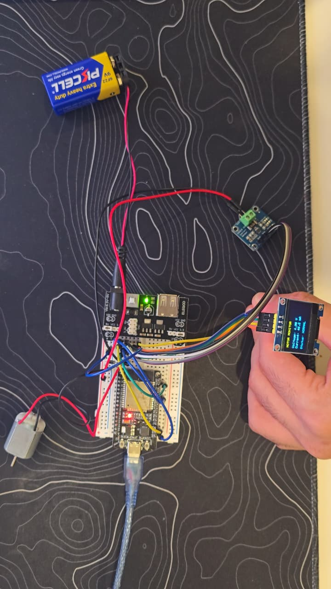
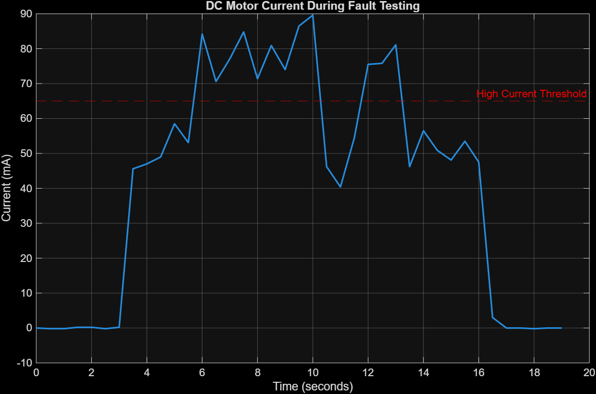
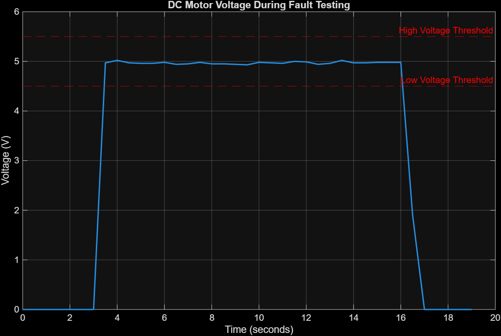

# ESP32 Motor Health Monitoring System

Real-time DC motor voltage and current monitoring with threshold-based fault detection using an ESP32, INA219 sensor, OLED display, and MATLAB.

## Project Overview

This project implements a real-time motor health monitoring system using an ESP32 microcontroller programmed in C++ through Arduino IDE.

An INA219 sensor measures motor voltage and current through I2C communication. The ESP32 continuously processes these measurements and detects abnormal operating conditions using predefined thresholds.

Measurements and fault alerts are displayed on a 0.96-inch OLED screen and through the Arduino IDE Serial Monitor.

## Technologies and Components

- ESP32 microcontroller
- C++ and Arduino IDE
- INA219 voltage and current sensor
- I2C communication
- 0.96-inch OLED display
- 3–6V DC motor
- Breadboard power supply module
- 1N4007 protection diode
- MATLAB for experimental data analysis

## Features

- Real-time motor voltage and current monitoring
- Threshold-based fault detection
- OLED display for live measurements and fault alerts
- Serial Monitor logging
- Two-second startup grace period to reduce false overcurrent alerts
- Experimental verification under three operating conditions
- MATLAB visualization of recorded motor measurements

## Hardware Setup

### INA219 to ESP32 Connections

| INA219 Pin | ESP32 Connection |
|---|---|
| VCC | 3V3 |
| GND | Common GND |
| SDA | GPIO 21 |
| SCL | GPIO 22 |

### OLED to ESP32 Connections

| OLED Pin | ESP32 Connection |
|---|---|
| VCC | 3V3 |
| GND | Common GND |
| SDA | GPIO 21 |
| SCL | GPIO 22 |

The INA219 and OLED share the same I2C bus.

- INA219 I2C address: `0x40`
- OLED I2C address: `0x3C`

### Motor Connections

| Component | Connection |
|---|---|
| Power supply 5V (+) | INA219 VIN+ |
| INA219 VIN− | Motor red wire |
| Motor black wire | Power supply GND |
| ESP32 GND | Common motor supply GND |

A 1N4007 diode is connected across the motor terminals for flyback protection, with its cathode on the motor's positive side.

The ESP32 is powered through USB, while the motor uses a separate regulated power supply.

## Fault Detection

The firmware compares measured voltage and current against predefined thresholds.

| Operating Condition | Threshold | OLED Alert |
|---|---|---|
| Normal operation | 4.5–5.5V and current ≤ 65mA | NORMAL |
| Low voltage | Below 4.5V | LOW VOLTAGE |
| High voltage | Above 5.5V | HIGH VOLTAGE |
| High current | Above 65mA after startup | HIGH CURRENT |

### Startup Grace Period

The motor briefly draws higher current during startup.

A two-second grace period prevents normal startup-current spikes from triggering false HIGH CURRENT alerts.

Voltage monitoring remains active during this period.

The thresholds were selected for the tested motor and are not universal protection limits.

## Experimental Testing

The system was evaluated under three different motor operating conditions.

### Test 1 — Normal Operation

The motor was powered at approximately 5V and operated without additional mechanical load.

**Observed results:**

- Voltage: Approximately 4.9–5.0V
- Typical operating current: Approximately 35–59mA
- OLED status: NORMAL

No unexpected fault alerts were observed during the recorded normal-operation tests after startup handling was implemented.

### Test 2 — Low Voltage

The motor supply voltage was reduced from 5V to 3.3V.

**Observed results:**

- Voltage: 3.3V
- Current: Approximately 39mA
- OLED status: LOW VOLTAGE

The ESP32 successfully detected the reduced supply voltage.

### Test 3 — High Current

Additional mechanical resistance was applied to the motor shaft to increase its electrical load.

**Observed results:**

- Normal current before increased load: Approximately 45–59mA
- Current during increased load: 70.6–89.6mA
- High-current threshold: 65mA
- OLED status: HIGH CURRENT

The system detected the increased current and returned to NORMAL when the additional load was removed.

## MATLAB Data Analysis

Experimental measurements were imported into MATLAB to visualize motor voltage and current during fault testing.

### Motor Current Analysis

The current graph shows the motor operating under normal conditions before experiencing increased mechanical load.

During the load test, current rises above the 65mA threshold, demonstrating the HIGH CURRENT detection condition.

When the additional mechanical load is removed, current returns to its normal operating range.

### Motor Voltage Analysis

The voltage graph shows that motor voltage remains approximately 5V during normal operation and increased mechanical loading.

Voltage drops toward zero when the motor supply is switched off.

The MATLAB graphs use an approximate 0.5-second sampling interval because the recorded test log does not include explicit timestamps.

## Project Files

| File | Description |
|---|---|
| `Motor_Health_Monitor.ino` | ESP32 C++ firmware |
| `motor_analysis.m` | MATLAB analysis script |
| `tests/high_current_test.txt` | Recorded experimental test data |
| `results/motor_current_plot.png` | Motor current analysis |
| `results/motor_voltage_plot.png` | Motor voltage analysis |
| `images/motor_monitor_setup.jpeg` | Completed hardware setup |

## Limitations

This project is a threshold-based monitoring prototype rather than a safety-rated motor protection system.

Fault thresholds are calibrated for the tested DC motor and operating conditions. The system reports abnormal measurements but does not automatically disconnect motor power.

When the motor supply is switched off, the firmware reports LOW VOLTAGE because it does not independently distinguish intentional shutdown from undervoltage.

## Conclusion

This project demonstrates practical electrical and computer engineering skills, including:

- Embedded C++ programming
- ESP32 hardware integration
- I2C sensor communication
- Real-time voltage and current monitoring
- Threshold-based fault detection
- Hardware troubleshooting and experimental verification
- MATLAB data analysis and visualization

The completed system successfully detected low-voltage and high-current conditions during controlled experiments while monitoring normal motor operation.
